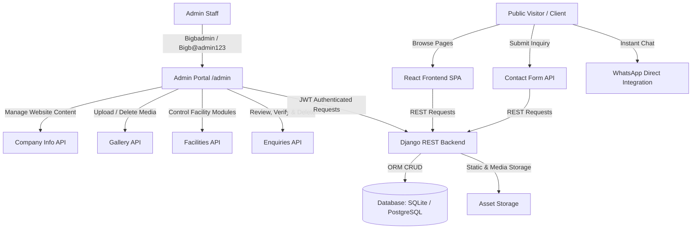

# BIGB WAREHOUSE PARK — COMPLETE SYSTEM DOCUMENTATION & ARCHITECTURAL SPECIFICATION

> **Document Version**: 2.4.0  
> **Last Updated**: October 2026  
> **Target Audience**: Stakeholders, Full-Stack Engineers, UI/UX Designers, System Administrators  
> **Platform Scope**: Public High-Performance Web Portal & Staff Admin Management System

---

## 1. Executive Summary & Vision

**BIGB Warehouse Park** is an industrial-grade logistics facility situated in Ezhippuram, Parippally, Kollam District, Kerala (adjacent to NH-66). The digital platform delivers a commercial web experience for enterprise clients seeking:
- High-bay industrial warehousing and covered storage
- Heavy-duty logistics operations (50-Ton certified digital weighbridge, mobile Hydra Crane lifting)
- Hassle-free union-free loading and unloading docks
- 24/7 monitored industrial compound with high-voltage 3-phase power infrastructure

The system comprises two unified subsystems:
1. **The Public Web Application**: A lightweight, responsive web experience utilizing a modern white industrial aesthetic, SVG vector graphics, micro-animations, and instant contact channels (direct inquiry form and WhatsApp integration).
2. **The Industrial Admin Portal**: A authenticated control room where staff manage live website text, high-resolution media gallery assets, facility modules, and client inquiries with verification badges and one-click deletion.



---

## 2. Technology Stack & Infrastructure

### 2.1 Frontend Architecture
- **Framework**: React 18 with Vite build tooling (HMR compile speed ~1.2s - 1.5s).
- **Routing**: `react-router-dom` (v6) with declarative routes and instant page scroll restoration via [`ScrollToTop.jsx`](file:///c:/Users/nabee/BigB/BIGBwarehouse/frontend/src/components/ScrollToTop.jsx).
- **Styling**: Tailwind CSS with custom theme extensions:
  - Custom safety orange tokens (`#F97316` / `brand-orange`)
  - Industrial blueprint grid patterns (`blueprint-grid-pattern`)
  - Custom light sweeps and subtle drop shadows
- **Iconography**: `lucide-react` for industrial system icons paired with official vector SVGs for third-party brands (e.g. WhatsApp official vector logo).
- **HTTP Client**: Axios with interceptor layers managing SimpleJWT bearer token lifecycle, header injection, and 401 retry guards.

### 2.2 Backend Architecture
- **Framework**: Django 6.1 with Django REST Framework (DRF).
- **Authentication**: `rest_framework_simplejwt` (JSON Web Tokens: Access Token + Refresh Token).
- **CORS Handling**: `django-cors-headers` configured for auto-whitelisting in `DEBUG` mode and strict origin matching in production.
- **Static & Media Asset Delivery**: `whitenoise` for compressed static assets alongside Django Media file storage.
- **Database Engine**: Development on `sqlite3` with native drop-in switch to PostgreSQL via environment variables (`DB_NAME`, `DB_USER`, `DB_PASSWORD`, `DB_HOST`, `DB_PORT`).

---

## 3. Design System & Aesthetics ("Pixel-Clear" Guide)

The platform adheres to a **Clean White Industrial & Technical Aesthetic**:

```
+-------------------------------------------------------------------------+
| PRIMARY PALETTE                                                         |
| • Background Canvas:    #F8FAFC (Slate-50)                              |
| • Card & Panel Canvas:  #FFFFFF (Pure White)                            |
| • Primary Typography:   #0F172A (Deep Slate-900)                        |
| • Muted Typography:     #64748B (Slate-500)                             |
| • Industrial Accent:    #F97316 (Brand Safety Orange)                   |
| • Accent Gradients:     from-brand-orange via-orange-500 to-amber-500   |
| • Verified Badge:       #047857 (Emerald-700) on #D1FAE5 (Emerald-100)  |
| • Danger / Delete:      #DC2626 (Red-600) on #FEF2F2 (Red-50)           |
+-------------------------------------------------------------------------+
```

### Key UI Signatures
1. **Blueprint Grid Accent**: Subtle 24px x 24px industrial grid backdrop (`blueprint-grid-pattern`) applied to sections requiring technical depth without visual clutter.
2. **Apple-Style Smooth Drawer Animation**: Mobile navigation utilizes cubic-bezier physics (`cubic-bezier(0.16, 1, 0.3, 1)`) with frosted glass backdrop blur (`backdrop-blur-md bg-white/95`) and seamless backdrop click-away dismissal.
3. **Official WhatsApp Vector Graphic**: Replaces generic icons with the official WhatsApp geometric chat bubble and phone silhouette across all call-to-actions.
4. **Card Hover Elevations**: Standardized 16px to 24px border radii (`rounded-2xl`, `rounded-3xl`), 1px slate borders (`border-slate-200`), and smooth hover lift animations (`hover:shadow-md hover:border-slate-300 transition-all`).

---

## 4. Public Pages Breakdown

### 4.1 Global Navigation Header ([`Navbar.jsx`](file:///c:/Users/nabee/BigB/BIGBwarehouse/frontend/src/components/Navbar.jsx))
- **Brand Typography**: High-contrast black `BIG` with safety orange `B` accented by the subtitle `WAREHOUSE PARK · PARIPPALLY`.
- **Desktop Navigation**: Horizontal links (`Home`, `About`, `Facilities`, `Gallery`, `Location & Contact`) with active state indicator lines.
- **Quick Action**: "BOOK WAREHOUSE" CTA button directing to contact form.
- **Mobile Menu Drawer**:
  - Morphing animated hamburger icon transitions into an 'X' icon.
  - Backdrop dimming layer with outside-click detection automatically closes menu when tapping anywhere outside the drawer.
  - Full mobile navigation list with phone and location shortcuts.

### 4.2 Home Page ([`Home.jsx`](file:///c:/Users/nabee/BigB/BIGBwarehouse/frontend/src/pages/Home.jsx))
- **Hero Section**:
  - Full-width industrial backdrop banner featuring high-bay interior.
  - Headline: *"BIGB WAREHOUSE PARK — More Than Storage. A Complete Space for Your Business."*
  - Dual CTAs: "Explore Facilities" & "Get Free Quote".
- **Live Specifications Matrix**:
  - 50-Ton Certified Weighbridge metric card
  - Mobile Hydra Crane on-site card
  - 24/7 Monitored Compound card
  - Union-Free Labor Management card
- **Featured Infrastructure Showcase**: Dynamically populated preview of facilities and gallery pictures.
- **Normalized CTA Banner**: Reusable [`CtaBanner.jsx`](file:///c:/Users/nabee/BigB/BIGBwarehouse/frontend/src/components/CtaBanner.jsx) integrating phone, map, and WhatsApp channels.

### 4.3 About Page ([`About.jsx`](file:///c:/Users/nabee/BigB/BIGBwarehouse/frontend/src/pages/About.jsx))
- **Industrial Narrative**: Details the logistical advantages of Ezhippuram, Parippally, Kollam District along the NH-66 corridor connecting Trivandrum and Kollam.
- **Technical Capabilities**: High clearance ceilings, heavy-duty floor load capacities, dedicated transformer power grids, and wide-turning yard radius for multi-axle freight containers.

### 4.4 Facilities Page ([`Facilities.jsx`](file:///c:/Users/nabee/BigB/BIGBwarehouse/frontend/src/pages/Facilities.jsx))
Features 7 standardized modular facility cards:
1. **High-Bay Industrial Storage**: High ceiling clearance, weather-resistant roofing, heavy load floor rating.
2. **50-Ton Digital Weighbridge**: Certified electronic scale for instant gross/tare vehicle weighing.
3. **Hydra Crane Heavy Lifting**: On-site mobile crane support for heavy machinery, coils, and equipment handling.
4. **Dedicated Power & High Capacity Grid**: 3-phase industrial power supply with generator backup provisions.
5. **24/7 Security & High-Definition CCTV**: Boundary perimeter security, gated entry logs, and full night illumination.
6. **Union-Free Dock Operations**: Direct corporate cargo handling with zero labor interruption.
7. **Multi-Axle Truck Parking Yard**: Spacious turning radius and dedicated overnight container parking.

### 4.5 Gallery Page ([`Gallery.jsx`](file:///c:/Users/nabee/BigB/BIGBwarehouse/frontend/src/pages/Gallery.jsx))
- **Dynamic Category Filters**: Filter by `All`, `Warehouse`, `Facilities`, and `Equipment`.
- **Interactive Lightbox Modal**: Clicking any image opens a full-screen high-resolution modal with image title, category tag, and caption.
- **Zero-Placeholder Guarantee**: Seeded with real photography of cranes, weighbridges, electrical hubs, and warehouse bays.

### 4.6 Contact & Location Page ([`Contact.jsx`](file:///c:/Users/nabee/BigB/BIGBwarehouse/frontend/src/pages/Contact.jsx))
- **Inquiry Form**:
  - `Full Name`: Required text input.
  - `Company Name`: Optional company name input.
  - `Phone Number`: Required phone input.
  - `Email Address`: Required email input.
  - `Requirement Category`: Dropdown (e.g., *Warehouse Space Lease*, *3PL Logistics*, *Weighbridge Services*, *Hydra Crane Rental*).
  - `Additional Message`: **Optional** textarea with clean placeholder assistance.
- **Google Maps Integration**: Responsive satellite/hybrid embed showing exact route to Ezhippuram, ESI Back Road, Parippally.
- **Direct Contact Badges**: Immediate click-to-call (`+91 7909294488`), click-to-email (`contact@bigbwarehouse.com`), and direct WhatsApp link.

### 4.7 Floating WhatsApp Widget ([`WhatsAppButton.jsx`](file:///c:/Users/nabee/BigB/BIGBwarehouse/frontend/src/components/WhatsAppButton.jsx))
- Fixed position in bottom right corner (`bottom-6 right-6 z-40`).
- Features official WhatsApp green gradient, radial glow shadow, and pulsing online status dot.
- Automatically launches `https://wa.me/917909294488` with pre-filled inquiry greeting.

### 4.8 Modern Footer ([`Footer.jsx`](file:///c:/Users/nabee/BigB/BIGBwarehouse/frontend/src/components/Footer.jsx))
- **Map Vignette**: Embedded satellite preview of the Parippally logistics park with external Google Maps link.
- **Corporate Credentials**: Address, GST/Registration details, direct contact numbers.
- **Smooth Back-to-Top**: Integrated button that smoothly scrolls users back to page top using window scroll API.

---

## 5. Admin Portal Specification ([`AdminPortal.jsx`](file:///c:/Users/nabee/BigB/BIGBwarehouse/frontend/src/pages/AdminPortal.jsx))

Accessible via `/admin` and `/admin-portal`.

### 5.1 Authentication System
- **Credentials**:
  - **Username**: `Bigbadmin`
  - **Password**: `Bigb@admin123`
- **Password Reveal Feature**: Eye toggle button (`Eye` / `EyeOff`) within the password input to reveal and verify entered text before submit.
- **Input Sanitization**: Automatically trims whitespace on username and password to prevent accidental copy-paste errors.
- **Session Persistence**: JWT tokens (`access_token` and `refresh_token`) stored securely in `localStorage` with automated verification on mount.

### 5.2 Hub 1: Website Content & Words Editor
Allows instant modification of all public marketing copy without touching source code:
- Company Title & Tagline
- Hero Title, Hero Subtitle & Hero Description
- About Text & Infrastructure highlights
- Phone Number, Email, WhatsApp number, Physical Address, and Google Maps embed URL

### 5.3 Hub 2: Media Gallery Manager
- Full image listing with category badges.
- **Add Picture Modal**: Upload new photos with title, category, and file upload.
- **Visibility Toggle**: Instantly hide or show images on the public gallery.
- **Delete Action**: Confirmation-backed removal of images from the database and disk.

### 5.4 Hub 3: Facilities Infrastructure Manager
- Cards displaying all 7 industrial services.
- Toggle active/inactive status.
- Add new facility modules with custom descriptions and icons.

### 5.5 Hub 4: Client Enquiries & Inbox
- **Real-Time Client Inquiries**: Displays incoming messages submitted via the public contact form.
- **Client Metadata**: Full Name, Company, direct `mailto:` and `tel:` links, requirement tag, and timestamp.
- **Verification Status**:
  - Toggle between **PENDING REVIEW** (amber badge) and **VERIFIED** (emerald badge with checkmark).
- **Delete Enquiry Button**:
  - Red button (`DELETE ENQUIRY` with trash icon).
  - Prompts confirmation dialog to prevent accidental deletion.
  - Sends authenticated `DELETE /api/enquiries/{id}/` returning HTTP 204.
- **Empty State**: Custom industrial dashed container when no inquiries are pending.
- **Refresh Action**: On-demand manual sync button with spinning feedback icon.

---

## 6. Database Models & Schema ([Django ORM](file:///c:/Users/nabee/BigB/BIGBwarehouse/backend))

### 6.1 `Company` Model (`company/models.py`)
```python
class Company(models.Model):
    name = models.CharField(max_length=255)
    tagline = models.CharField(max_length=255, blank=True)
    description = models.TextField(blank=True)
    hero_title = models.CharField(max_length=255, blank=True)
    hero_subtitle = models.CharField(max_length=255, blank=True)
    about_text = models.TextField(blank=True)
    hero_image = models.ImageField(upload_to='company/', blank=True, null=True)
    phone = models.CharField(max_length=50, blank=True)
    email = models.EmailField(blank=True)
    whatsapp = models.CharField(max_length=50, blank=True)
    address = models.TextField(blank=True)
    google_maps_url = models.TextField(blank=True)
    updated_at = models.DateTimeField(auto_now=True)
```

### 6.2 `Facility` Model (`facilities/models.py`)
```python
class Facility(models.Model):
    title = models.CharField(max_length=255)
    description = models.TextField()
    icon = models.CharField(max_length=100, default='Warehouse')
    image = models.ImageField(upload_to='facilities/', blank=True, null=True)
    image_url = models.URLField(max_length=500, blank=True)
    is_active = models.BooleanField(default=True)
    order = models.IntegerField(default=0)
    created_at = models.DateTimeField(auto_now_add=True)
```

### 6.3 `GalleryImage` Model (`gallery/models.py`)
```python
class GalleryImage(models.Model):
    title = models.CharField(max_length=255)
    category = models.CharField(max_length=100, default='Warehouse')
    description = models.TextField(blank=True)
    image = models.ImageField(upload_to='gallery/', blank=True, null=True)
    image_url = models.URLField(max_length=500, blank=True)
    is_active = models.BooleanField(default=True)
    created_at = models.DateTimeField(auto_now_add=True)
```

### 6.4 `Enquiry` Model (`enquiries/models.py`)
```python
class EnquiryStatus(models.TextChoices):
    NEW = 'NEW', 'New'
    VERIFIED = 'VERIFIED', 'Verified'
    CONTACTED = 'CONTACTED', 'Contacted'
    IN_PROGRESS = 'IN_PROGRESS', 'In Progress'
    CLOSED = 'CLOSED', 'Closed'

class Enquiry(models.Model):
    full_name = models.CharField(max_length=255)
    company_name = models.CharField(max_length=255, blank=True)
    phone = models.CharField(max_length=50)
    email = models.EmailField()
    requirement = models.CharField(max_length=150)
    message = models.TextField()
    status = models.CharField(
        max_length=50, 
        choices=EnquiryStatus.choices, 
        default=EnquiryStatus.NEW,
        db_index=True
    )
    created_at = models.DateTimeField(auto_now_add=True)
    updated_at = models.DateTimeField(auto_now=True)
```

---

## 7. API Reference Matrix

| Endpoint | Method | Permissions | Purpose |
| :--- | :--- | :--- | :--- |
| `/api/auth/login/` | `POST` | Public | Authenticates username/password; returns JWT pair |
| `/api/auth/refresh/` | `POST` | Public | Exchanges valid refresh token for new access token |
| `/api/auth/me/` | `GET` | Authenticated | Retrieves current admin username, email, staff status |
| `/api/company/` | `GET` | Public | Returns company metadata, phone, email, addresses |
| `/api/company/{id}/` | `PATCH`/`PUT` | Staff Admin | Updates company text and content |
| `/api/facilities/` | `GET` | Public | Returns all active facility cards |
| `/api/facilities/` | `POST` | Staff Admin | Creates new facility card with image |
| `/api/facilities/{id}/` | `PATCH`/`DELETE` | Staff Admin | Updates status / Deletes facility |
| `/api/gallery/` | `GET` | Public | Returns active gallery images |
| `/api/gallery/` | `POST` | Staff Admin | Uploads new gallery picture |
| `/api/gallery/{id}/` | `PATCH`/`DELETE` | Staff Admin | Toggles visibility / Deletes picture |
| `/api/enquiries/` | `POST` | Public | Visitor contact form submission (status defaults to `NEW`) |
| `/api/enquiries/` | `GET` | Staff Admin | Lists all client submissions |
| `/api/enquiries/{id}/` | `PATCH` | Staff Admin | Updates status (e.g. `VERIFIED`, `CLOSED`) |
| `/api/enquiries/{id}/` | `DELETE` | Staff Admin | Permanently deletes enquiry record |

---

## 8. Deployment & Operational Runbook

### 8.1 Starting Development Environment
1. **Backend Server**:
   ```powershell
   cd backend
   .\venv\Scripts\python manage.py runserver 127.0.0.1:8000
   ```
2. **Frontend Dev Server**:
   ```powershell
   cd frontend
   npm run dev
   ```
   *Frontend is served on `http://localhost:5174/` (or `5173`).*

### 8.2 Seeding / Resetting Content & Admin User
To restore seed images, company copy, all 7 facilities, and the `Bigbadmin` user:
```powershell
cd backend
.\venv\Scripts\python seed_data.py
```

### 8.3 Building for Production
```powershell
cd frontend
npm run build
```
Generates production-optimized bundle in `frontend/dist/` with gzipped chunks and static assets.

---

*End of Documentation.*
